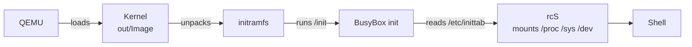

<div align="center">


<br/>


</div>

## 🐧 About

AA Linux is a small Linux distribution we're building from scratch: the Linux kernel, BusyBox and our own boot scripts. The goal is to understand every step a Linux system takes, from the moment the kernel starts to the shell prompt.

> **Status:** the build scripts are written, and the first boot in QEMU (arm64) is being tested. There is no package manager and no installation to disk yet.

## 🧩 What's inside

| Part | What it does |
| --- | --- |
| **Linux 6.18 LTS** | The kernel, built with the stock arm64 config and no modules |
| **BusyBox 1.38** | One static binary that provides the shell, `init` and the core commands |
| **initramfs** | The whole system is loaded into RAM at boot |
| **[`rootfs/`](rootfs)** | Our own files: init configuration, boot script, `os-release` |

## 🚀 How it boots



## 🛠 Build and run

**macOS (Apple Silicon)**

```sh
brew install qemu lima
./scripts/build-macos.sh
./scripts/run-qemu.sh
```

macOS can't build the Linux kernel, so `build-macos.sh` runs the build inside a Debian VM called `aa-builder` (created by [Lima](https://lima-vm.io) on the first run) and copies the result to `out/`.

**Linux (arm64, Debian or Ubuntu)**

```sh
sudo apt install build-essential bc bison flex libssl-dev libelf-dev cpio curl xz-utils bzip2 qemu-system-arm
./scripts/build.sh
./scripts/run-qemu.sh
```

To leave QEMU, type `poweroff`, or press `Ctrl-A` and then `X`.

## 📁 Repository layout

| Path | What it is |
| --- | --- |
| [`scripts/build.sh`](scripts/build.sh) | Downloads and checksums the sources, builds the kernel and BusyBox, packs the initramfs |
| [`scripts/build-macos.sh`](scripts/build-macos.sh) | Runs `build.sh` inside a Lima VM on macOS |
| [`scripts/run-qemu.sh`](scripts/run-qemu.sh) | Boots the result in QEMU |
| [`rootfs/`](rootfs) | Files copied into the root filesystem as they are |

## 🗺 Roadmap

- [ ] First boot to a shell in QEMU
- [ ] Our own package manager
- [ ] Boot on real hardware (x86_64 laptop from a USB stick)

## 🧰 Built with

<p align="left">
  
</p>

## 👥 Authors

- **Altai Abdurahim**
- **Atay Mahmudov**

<a href="https://github.com/Doosi41/aa-linux/graphs/contributors">
  
</a>

## 📄 License

[MIT](LICENSE)


