<div align="center">



<br/>


<sub>kernel + busybox + initramfs · built from source on an M2 MacBook</sub>

</div>

<br/>

### `~/about`

A tiny Linux distribution we're building by hand: our own kernel build, BusyBox and our own boot scripts. There's no Debian or Arch underneath, nothing we didn't put there ourselves. The point is to understand every step from power-on to the shell prompt.

> [!NOTE]
> **Status:** boots to a shell in QEMU on arm64. No package manager and no disk install yet.

### `~/first-boot`


<sub>Real output of <code>./scripts/run-qemu.sh</code>, kernel log trimmed.</sub>

### `~/inside`

```text
aa-linux 0.1
├── linux 6.18 lts     kernel, stock arm64 config, no modules
├── busybox 1.38       one static binary: sh, init, mount, ls and ~300 more
├── initramfs          the whole system lives in RAM
└── rootfs/            our files: inittab, rcS, os-release
```

### `~/boot-chain`

```text
power on
 └─▶ qemu loads Image + initramfs.cpio.gz
      └─▶ kernel unpacks the initramfs, runs /init (busybox init)
           └─▶ init reads /etc/inittab
                ├─▶ /etc/init.d/rcS   mounts /proc /sys /dev, sets the hostname
                └─▶ /bin/sh           on the console, restarted if it exits
```

### `~/build`

```sh
# macOS, Apple Silicon
brew install qemu lima
./scripts/build-macos.sh   # the first run sets up a Debian VM, later rebuilds take seconds
./scripts/run-qemu.sh
```

```sh
# Linux, arm64 (Debian / Ubuntu)
sudo apt install build-essential bc bison flex libssl-dev libelf-dev cpio curl xz-utils bzip2 qemu-system-arm
./scripts/build.sh
./scripts/run-qemu.sh
```

To leave: type `poweroff`, or press <kbd>Ctrl</kbd>+<kbd>A</kbd>, then <kbd>X</kbd>.

macOS can't build the Linux kernel, so `build-macos.sh` builds inside a [Lima](https://lima-vm.io) VM called `aa-builder` and copies the result to `out/`.

### `~/tree`

```text
.
├── scripts/
│   ├── build.sh          fetch + checksum sources, build kernel & busybox, pack initramfs
│   ├── build-macos.sh    same, inside a lima vm
│   └── run-qemu.sh       boot it
├── rootfs/               copied into / as-is
│   └── etc/
│       ├── inittab
│       ├── init.d/rcS
│       └── os-release
└── assets/               images for this readme
```

### `~/roadmap`

- [x] Boot to a shell in QEMU
- [ ] Our own package manager
- [ ] Real hardware: an old x86_64 laptop, booted from a USB stick

### `~/crew`

**Altai Abdurahim** · **Atay Mahmudov**

<br/>

<div align="center">
<sub><a href="LICENSE">MIT</a> · made by altai × atay</sub>
</div>
