<div align="center">



<br/><br/>


<sub>kernel + busybox + initramfs · built from source on an M2 MacBook · power-on to <code>/init</code> in 0.24 s</sub>

</div>

<br/>


A tiny Linux distribution we're building by hand: our own kernel build, BusyBox and our own boot scripts. There's no Debian or Arch underneath, nothing we didn't put there ourselves. The point is to understand every step from power-on to the shell prompt.

> [!NOTE]
> **Status:** boots to a shell in QEMU on arm64. No package manager and no disk install yet.

<br/>




<sub>Real output of <code>./scripts/run-qemu.sh</code>, kernel log trimmed.</sub>

<br/>




<br/>




<br/>


```sh
# macOS, Apple Silicon
brew install qemu lima
./scripts/build-macos.sh   # the first run sets up a Debian VM, later rebuilds take seconds
./scripts/run-qemu.sh
```

```sh
# Linux, arm64 (Debian / Ubuntu)
sudo apt install build-essential bc bison flex libssl-dev libelf-dev cpio curl xz-utils bzip2 qemu-system-arm
./scripts/build.sh
./scripts/run-qemu.sh
```

To leave: type `poweroff`, or press <kbd>Ctrl</kbd>+<kbd>A</kbd>, then <kbd>X</kbd>.

macOS can't build the Linux kernel, so `build-macos.sh` builds inside a [Lima](https://lima-vm.io) VM called `aa-builder` and copies the result to `out/`. The pictures in this README are drawn by [`assets/generate.py`](assets/generate.py).

<br/>




<br/>

<a href="LICENSE"></a>
